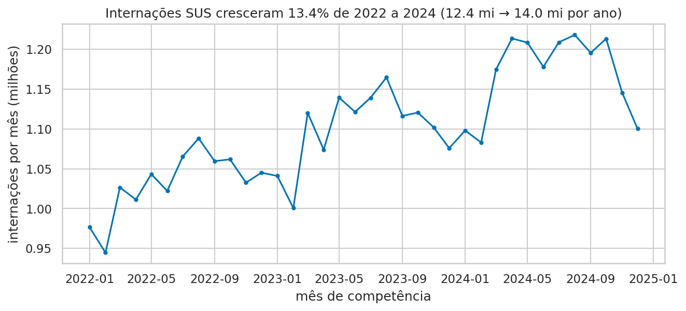
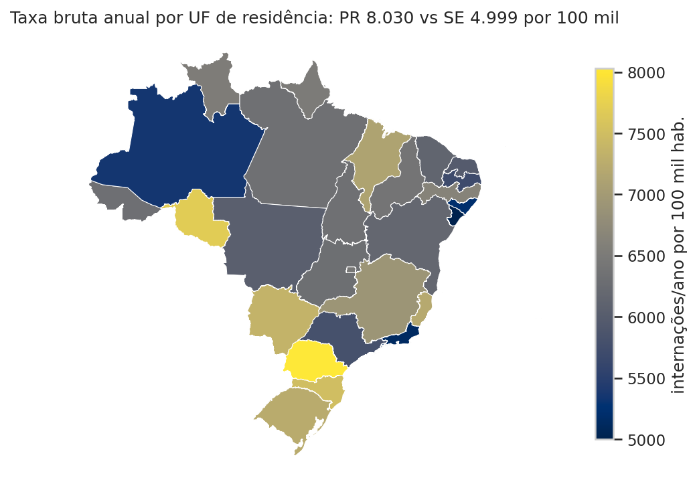
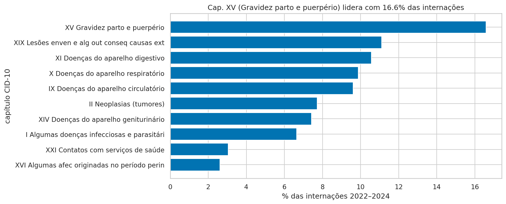
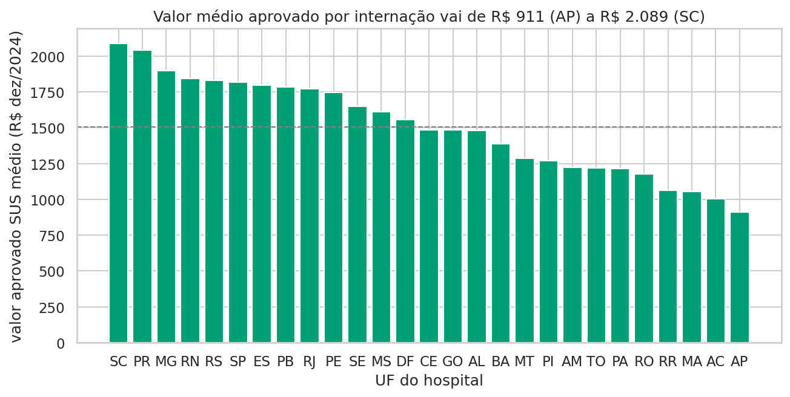
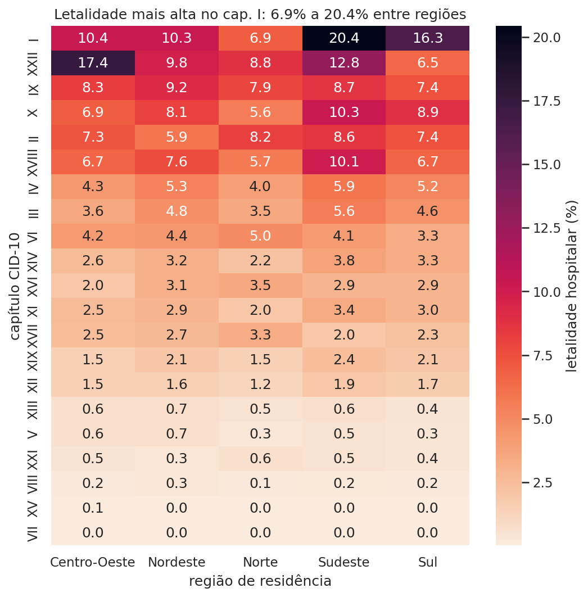
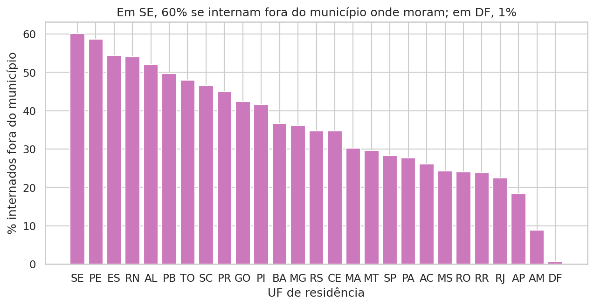

# 1. Contexto e perguntas

O Sistema de Informações Hospitalares do SUS (SIH/SUS) registra cada internação paga pelo SUS numa Autorização de Internação Hospitalar (AIH). O arquivo reduzido (RD) traz, por AIH, o paciente (idade, sexo, raça/cor, município de residência), o diagnóstico principal (CID-10), o procedimento, as datas, a permanência, o óbito e o valor aprovado. O recorte do projeto cobre as 27 UFs e os 36 meses de 2022 a 2024, num pipeline reprodutível em camadas bronze → silver → gold, com PySpark e PostgreSQL. O trabalho busca um panorama geral e responde a cinco perguntas:

1. **Tendência:** como evoluíram as internações e a taxa bruta por 100 mil habitantes por UF de residência? Há sazonalidade?
2. **Causas:** quais capítulos da CID-10 mais internam?
3. **Valor aprovado:** qual o valor médio aprovado pelo SUS por internação, por UF do hospital?
4. **Permanência e óbito:** como a permanência e a letalidade hospitalar variam por idade, sexo e causa?
5. **Desigualdade regional:** que proporção dos pacientes se interna fora do município onde mora?

# 2. Fontes e volume

| Fonte | Conteúdo | Acesso |
|---|---|---|
| DATASUS SIH/RD | 972 arquivos `.dbc` (27 UFs × 36 meses) | FTP `ftp.datasus.gov.br` |
| IBGE/SIDRA | população municipal (Censo 2022, estimativa 2024; 2023 interpolado) e IPCA mensal | API SIDRA |
| DATASUS TabWin | CID-10 → capítulo, códigos de município (`.cnv`, largura fixa) | FTP |
| IBGE/geobr | malhas de municípios e UFs | pacote `geobr` |

| Métrica | Valor |
|---|---|
| Arquivos / meses / UFs | 972 / 36 / 27 |
| Linhas (AIHs) | 40.048.092 |
| Colunas no DBF | 113, iguais nos três anos (hash do layout idêntico) |
| Tamanho DBC → Parquet bronze | 3,0 GB → 2,1 GB (snappy, todas as colunas como texto) |
| Silver tipada / gold | 1,6 GB (35 colunas) / fato com 12,7 mi linhas |

O Parquet compensou: num mês de SP (2,67 mi linhas), o CSV ocupa 1.265 MB e o Parquet 129 MB. Ler 4 colunas levou 9,3 s no CSV e 0,8 s no Parquet, porque o formato colunar só lê as colunas pedidas.

**Dificuldades da coleta.** O FTP do DATASUS derruba conexões com frequência (erro `425`). A solução foi gravar o download num `.part`, conferir o tamanho e só então renomear, com 5 tentativas e espera crescente; arquivos completos são pulados ao rodar de novo. O formato `.dbc` (DBF comprimido) exigiu o `pyreaddbc`. A tabela de CID em CSV citada na documentação não existe no FTP, então os capítulos vieram do `.cnv` do TabWin. A tabela 6579 do SIDRA não tem 2022 e 2023, então 2022 veio do Censo e 2023 foi interpolado linearmente. Os metadados de cada arquivo estão em `reports/metadados_coleta.csv`.

# 3. Problemas de qualidade e decisões

Nenhuma linha foi apagada. Os problemas foram corrigidos, viraram a categoria `ignorado` ou foram marcados com uma flag. O log completo (16 regras) está em `reports/log_limpeza.csv` e é regravado a cada execução.

| Problema | Linhas afetadas | Decisão |
|---|---|---|
| Outlier de `VAL_TOT` (IQR por procedimento) | 4.673.037 | marcado, não removido: procedimentos caros são reais |
| Outlier de `DIAS_PERM` (IQR por procedimento) | 2.829.313 | marcado |
| `RACA_COR` = 99 (sem informação) | 2.778.438 | categoria `ignorado`; 19% em 2022 e 0,02% em 2024 |
| AIH de longa permanência (`IDENT=5`) | 417.700 | fica fora das contagens, porque continua uma internação já contada |
| `DIAS_PERM` ≠ saída − entrada | 413.848 | mantido o valor informado (regra de cobrança do SIH) |
| `VAL_TOT` ≤ 0 | 124.309 | vira nulo nas médias, mas a internação continua nas contagens |
| Idade inválida (> 120 anos ou código 0) | 454 | faixa `ignorado` |
| CID U09/U10 fora da tabela TabWin | 184 | atribuído ao capítulo XXII |

Outras decisões: `UF_ZI` é o município gestor, não a UF; a UF de residência vem de `MUNIC_RES` e a UF do hospital vem do arquivo. Os códigos de município de 7 dígitos foram cortados para 6, e `000000` virou `ignorado`. `VAL_TOT` é o **valor aprovado pelo SUS**, e não o custo real; ele foi deflacionado pelo IPCA para dez/2024. Duplicatas exatas: zero. Todas as repetições de `N_AIH` são AIHs de longa permanência.

# 4. Resultados

**Q1 — Tendência.** As internações passaram de 12,4 milhões em 2022 para 14,0 milhões em 2024 (+13,4%). A série mostra queda em janeiro e fevereiro e alta de março a agosto (Figura 1). A queda em nov–dez de 2024 é, ao menos em parte, atraso de processamento: AIHs podem ser apresentadas até meses depois. A taxa bruta anual varia de 4.999 internações por 100 mil habitantes em SE a 8.030 no PR (Figura 2). Taxas baixas no Nordeste combinam com a menor cobertura da rede SUS em algumas UFs e com o fato de que parte dos moradores se interna em UFs vizinhas.

{width=95%}

{width=55%}

**Q2 — Causas.** Gravidez, parto e puerpério (cap. XV) lideram com 16,6% das internações. Depois vêm lesões e causas externas (XIX, 11%), aparelho digestivo (XI), respiratório (X) e circulatório (IX) (Figura 3).

{width=85%}

**Q3 — Valor aprovado.** O valor médio aprovado por internação vai de R\$ 911 (AP) a R\$ 2.089 (SC), a preços de dez/2024 (Figura 4). Sul e Sudeste concentram hospitais de alta complexidade (cardiologia, oncologia, UTI). O valor acompanha os dias de UTI (ρ = 0,46) mais do que a idade (ρ = 0,19), na correlação de Spearman sobre uma amostra de 2% (figura 5 do notebook).

{width=90%}

**Q4 — Permanência e óbito.** A permanência mediana sobe de 2 dias (20–29 anos) para 4 dias (80+). Homens ficam mais tempo entre 15 e 69 anos, e a diferença some acima de 70 anos. A letalidade hospitalar cresce com a idade, de 0,4% (5–9 anos) e 0,6% (20–29) para 7,4% (60–69) e 18,4% (80+); menores de 5 anos ficam em 1,6%, pelo peso dos recém-nascidos. Por causa, as doenças infecciosas (cap. I, que inclui sepse) têm a maior letalidade: 20,4% no Sudeste e 6,9% no Norte. Os códigos especiais (XXII, COVID-19) chegam a 17,4% no Centro-Oeste (Figura 5).

{width=70%}

**Q5 — Internação fora do município.** Em SE, 60% dos pacientes se internam fora do município onde moram; em PE, 58%; em ES, RN e AL, mais de 50%. No DF, praticamente 0%, porque o DF é um município só (Figura 6). Esses números mostram quanto a internação se concentra nas capitais e nos polos regionais, e o quanto o paciente precisa se deslocar.

{width=90%}

O notebook (`notebooks/projeto_final.ipynb`, seção 4) traz também a permanência por idade e sexo, a matriz de correlação e o antes/depois da limpeza. O dashboard em Power BI, montado sobre o schema `dw` do PostgreSQL, segue `reports/tutorial_powerbi.md`.

# 5. Limitações

- As taxas são **brutas**: o denominador é a população total, sem padronização por idade. UFs mais envelhecidas tendem a ter taxas maiores.
- `VAL_TOT` é o valor de reembolso da tabela SUS, e não o custo real.
- A população de 2023 é interpolada; a de 2024 é estimativa.
- O SIH cobre só internações pagas pelo SUS. A rede privada e os planos de saúde ficam de fora, o que pesa mais nas UFs com mais beneficiários de planos.
- Os últimos meses podem estar incompletos por atraso no envio das AIHs.
- Hadoop (HDFS) e MongoDB não foram usados. Os 40 milhões de linhas cabem em uma máquina com Spark local e Parquet, e o dado é tabular e bem estruturado, o que favorece um banco relacional (PostgreSQL) para o modelo estrela.

# 6. Próximos passos (Parte 2)

- Taxas padronizadas por idade, usando a população por faixa etária do IBGE.
- Séries temporais com decomposição de sazonalidade e previsão de demanda por UF.
- Modelos de risco de óbito hospitalar (idade, causa, UTI, região).
- Fluxos origem–destino entre municípios (pacientes que se deslocam), com análise de rede.
